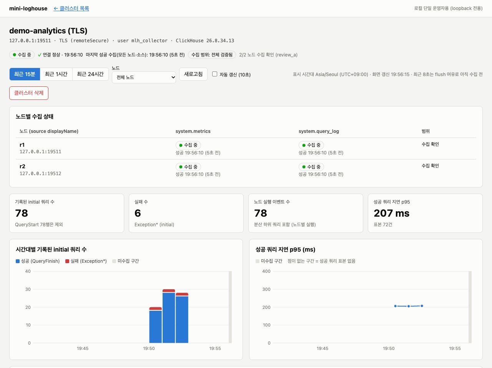
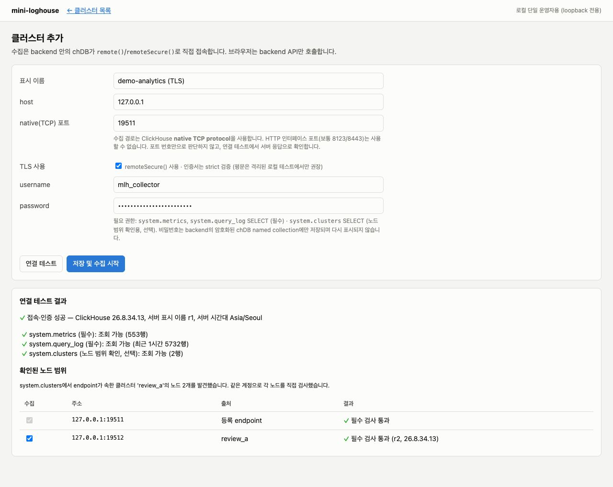
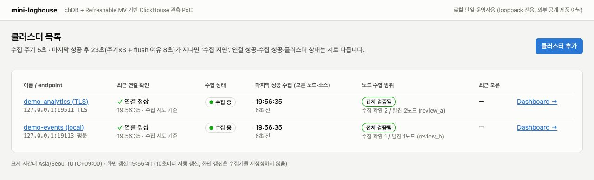
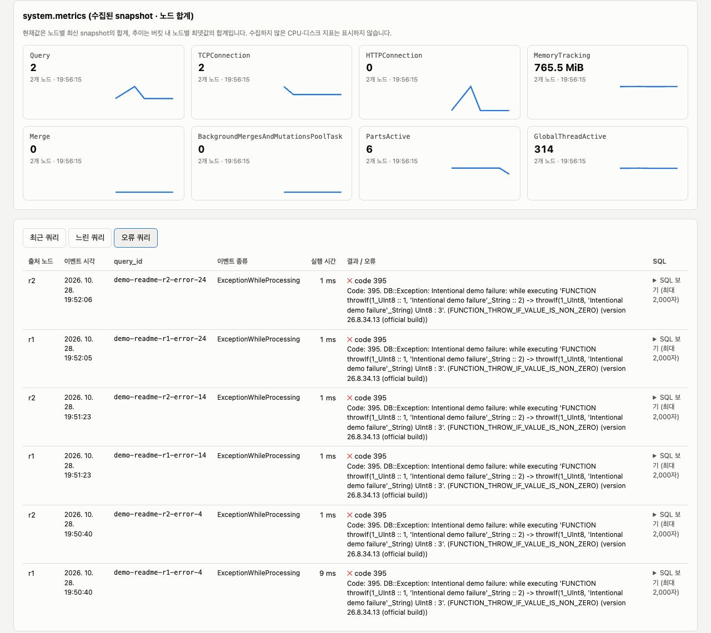
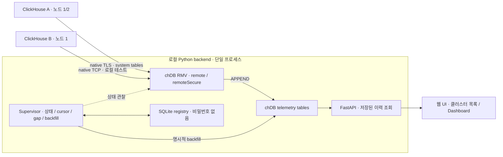

# chDB Mini LogHouse PoC

**별도 수집 서비스 없이, 앱 안의 chDB가 여러 ClickHouse의 system table을 직접 수집하고 보여 줄 수 있을까?**

Mini LogHouse는 이 질문을 검증하는 **로컬 단일 운영자용 관측 앱**입니다. 웹에서 ClickHouse 클러스터를 등록하면, backend에 내장된 chDB의 **Refreshable Materialized View**(RMV)와 `remote()` / `remoteSecure()`가 노드별 `system.metrics`와 `system.query_log`를 주기적으로 가져옵니다. Dashboard는 원격 클러스터를 매번 조회하지 않고 **로컬에 쌓인 이력**을 읽습니다.

> **상태: 작동하는 실험용 PoC — production-ready 아님.** 실제 2개 클러스터·3개 노드에서 등록 → 수집 → Dashboard와 재시작 복구를 확인했습니다. 별도 리뷰에서는 장애 격리·집계 범위·UI 비동기 처리 등 **주요 미해결 문제 7건**도 재현했습니다. [검증 결과와 알려진 문제](reports/independent-review-2026-10-28.md)를 함께 읽어 주세요. 저장소의 Public 공개는 **소스 공개**이며, 앱을 인터넷에 공개 배포한 것이 아닙니다.



*실제 앱 화면, 2026-10-28. 격리된 로컬 ClickHouse에 성공·실패 쿼리를 실행한 뒤 RMV가 수집한 데이터입니다. Mockup이나 합성 차트가 아닙니다. 화면의 실패는 의도적으로 발생시킨 테스트 쿼리입니다.*

[빠른 시작](#빠른-시작) · [실제 화면](#실제-화면과-사용자-흐름) · [검증 결과](#무엇을-확인했나) · [한계](#리스크와-다음-단계) · [원래 PoC 명세](docs/poc-goal.md)

## 왜 이 PoC를 만들었나

출발점은 ClickHouse가 자사 Cloud 관측 시스템을 소개한 **LogHouse**였습니다. 여러 ClickHouse의 내부 상태와 실행 이력을 한곳에서 볼 수 있다는 아이디어에서, 훨씬 작은 실험 질문을 꺼냈습니다.

> “SysEx 같은 별도 수집 서비스를 두지 않고, chDB 자체를 SQL 기반 수집기이자 로컬 분석 저장소로 쓸 수 없을까?”

공식 LogHouse는 system-table 수집뿐 아니라 대규모 운영을 위한 파이프라인을 다룹니다. 이 프로젝트는 그 구현을 복제하는 것이 아니라, **수집·저장·조회를 한 앱에 넣었을 때 어디까지 성립하고 어디서 한계가 나타나는지**를 확인합니다. 배경: [LogHouse의 system-table 수집 설계](https://clickhouse.com/blog/scaling-observability-beyond-100pb-wide-events-replacing-otel), [후속 확장 아키텍처](https://clickhouse.com/blog/a-quadrillion-rows-across-the-three-cloud-scaling-loghouse).

이 PoC의 의미는 화려한 차트보다 다음 세 가지에 있습니다.

1. **chDB의 역할 확장 실험** — 일회성 분석 쿼리뿐 아니라, 영속 Session을 가진 상주 앱 안에서 RMV가 실제로 반복 실행되는가?
2. **작은 구성으로 끝까지 연결** — endpoint·계정 등록부터 TLS·권한 검사, 데이터 저장, 재시작, 웹 조회까지 별도 중앙 ClickHouse 서버 없이 이어지는가?
3. **관측 결과를 얼마나 믿을 수 있는가** — 접속 성공, 수집 성공, 전체 노드 확인, 최신 데이터, 실제 0건은 서로 다릅니다. 이 차이를 표현하고 반례까지 확인하는 것이 실험의 핵심입니다.

ClickHouse의 공식 제품이나 LogHouse의 축소 배포판이 아닙니다. 기존 모니터링 스택을 대체한다고 주장하지 않습니다.

## 실제 화면과 사용자 흐름

### 1. 클러스터 추가 → 연결·권한·노드 검사

표시 이름, host, **native TCP port**, TLS 여부, 계정과 password를 입력합니다. 연결 테스트는 인증 성공과 system table 조회 권한을 구분하며, `system.clusters`에서 발견한 노드도 직접 검사합니다. HTTP 포트(예: 8123/8443)는 수집 endpoint가 아닙니다.



*캡처에는 일회용 테스트 계정만 사용했고 password는 masked input입니다. 서버 인증서를 검증한 TLS 연결입니다.*

### 2. 목록에서 여러 클러스터의 수집 상태 확인

저장하면 수집이 시작됩니다. 목록에서는 최근 연결 확인, 수집 상태, 마지막 성공 시각, 확인된 노드 범위를 구분해서 봅니다.



*`demo-analytics`는 TLS 2노드, `demo-events`는 격리된 로컬 평문 1노드입니다. “수집 중”은 애플리케이션의 수집 상태이지, 원격 클러스터 전체의 건강을 보증하는 판정이 아닙니다.*

### 3. Dashboard에서 기간·노드·쿼리 상세 확인

- 최근 **15분 / 1시간 / 24시간**, 전체 또는 개별 노드 선택
- initial 쿼리 수·실패 수·노드 실행 이벤트 수·성공 쿼리 p95
- 쿼리 수와 지연 추이, `system.metrics`의 주요 metric과 시계열
- 최근 / 느린 / 오류 쿼리, 출처 노드·실행 시간·접힌 SQL
- 수동 새로고침, 10초 자동 화면 갱신



캡처 환경과 재현 방법은 [스크린샷 기록](docs/screenshots/README.md)에 있습니다. 등록·상태·조회 흐름은 동작하지만 **coverage와 freshness 표시에 알려진 반례가 있습니다**. 정상 화면만으로 모든 장애 조건이 통과했다고 해석하면 안 됩니다.

## 어떻게 동작하나



화살표는 **데이터 흐름**입니다. source가 push하는 것이 아니라 chDB가 source를 pull합니다. 각 노드에 별도 수집 agent를 설치하지 않습니다.

| 책임 | 구현과 의미 |
|---|---|
| 정기 수집 | 노드별 metrics/query_log RMV. 브라우저가 아니라 backend의 수명에 묶임 |
| metric 이력 | 관측 시각을 붙인 snapshot을 `MergeTree`에 APPEND |
| query log | lag + overlap window 재조회 → `ReplacingMergeTree` → 조회 시 `FINAL` 중복 제거 |
| 장애 후 복구 | Supervisor가 성공 시각·cursor·gap을 보존하고 명시적 backfill 수행 |
| 등록 정보 | SQLite. chDB 복구 모드에서도 등록·상태 확인 가능 |
| 자격증명 | 암호화된 chDB named collection. 키는 data directory 밖에 보관 |
| UI | FastAPI + vanilla HTML/JS + SVG chart. frontend build / 외부 CDN 없음 |

**RMV의 APPEND는 자동 증분 cursor나 exactly-once 보장이 아닙니다.** 중복 제거, 지연 flush, 중단 구간 복구는 별도 설계가 필요합니다. 또한 프로세스를 종료하면 수집도 멈춥니다. 이 동작과 제약을 [기술타당성 보고서](reports/feasibility.md)에 기록했습니다.

## 무엇을 확인했나

2026-10-28 독립 리뷰 기준입니다. 아래 수치는 작은 고정 workload의 결과이지, 대규모 처리 성능이나 모든 이벤트의 무손실 보장이 아닙니다.

| 검증 | 관측 결과 | 근거 |
|---|---|---|
| 실제 2+1 노드 수집 | 식별한 source 이벤트 24행 = destination `FINAL` 24행 | [baseline](reports/review-evidence/baseline-results.json) |
| backend 중단·복구 | 약 36초 중단 중 발생시킨 26행 모두 backfill로 복구; 등록 유지 | [restart](reports/review-evidence/restart-results.json) |
| overlap 중복 | raw 32행 → `FINAL` 16행, 예상 이벤트 16행과 일치 | [overlap](reports/review-evidence/overlap-results.json) |
| 실패 분류 | 인증·권한·연결 거절·TLS mismatch·CA 검증 실패 분리 | [probe matrix](reports/review-evidence/probe-matrix.json) |
| 키 복구·중복 실행 | 키 누락/불일치 시 복구 모드, 원키 복원 후 정상; 두 번째 owner 거부 | [recovery](reports/review-evidence/key-recovery-results.json) |
| 기존 단위 테스트 | 55 passed. 이 결과만으로 아래 리뷰 반례가 해결된 것은 아님 | [독립 리뷰](reports/independent-review-2026-10-28.md) |

테스트한 조합은 **macOS 27.0.1 arm64 / Python 3.11 / chDB 4.4.0 / chdb-core 26.9.0(내장 engine 26.9.2.1) / source ClickHouse 26.8.34.13**입니다. 다른 OS·버전·Cloud 환경의 동작은 별도 확인이 필요합니다.

## 빠른 시작

아래는 **macOS arm64에서 검증한 로컬 데모 경로**입니다. Python 3.11, [uv](https://docs.astral.sh/uv/), `openssl`, 여유 디스크가 필요합니다. venv와 테스트 바이너리만 약 1.5 GB이며 데이터가 추가됩니다.

### 1. 설치

```bash
git clone https://github.com/CYRok90/mini-loghouse-poc.git
cd mini-loghouse-poc
scripts/setup.sh
```

dependency는 `uv.lock`에 고정되어 있습니다. 이번 macOS 환경에서 발견한 wheel의 Mach-O 정렬 문제는 setup script가 **venv 사본만** 패치합니다. Linux는 별도 검증하지 않았으며 아래 바이너리는 Linux용이 아닙니다. 자세한 내용은 [실행 가이드](docs/operations.md)를 참고하세요.

### 2. 일회용 source 3개 실행

```bash
mkdir -p .tools
curl -fL -o .tools/clickhouse \
  https://github.com/ClickHouse/ClickHouse/releases/download/v26.8.34.13-lts/clickhouse-macos-aarch64
echo 'd1666bb409243aee970c6ea76d8b97e18cbcb6351d61d52dd3d88baab14d26db  .tools/clickhouse' | shasum -a 256 -c -
chmod +x .tools/clickhouse

.venv/bin/python scripts/testenv.py init
.venv/bin/python scripts/testenv.py start
.venv/bin/python scripts/testenv.py status
```

SHA256은 **첫 실행 전 다운로드 파일**의 검증값입니다. 이 fixture는 loopback에만 bind합니다. `init`이 무작위 테스트 계정과 로컬 CA를 만들며, 비밀번호는 로컬 secrets 파일인 `var/testenv/secrets.json`에 있습니다. Git·이슈·공유 화면에 복사하지 마세요.

### 3. 앱 실행 → 웹에서 등록

```bash
set -a; source scripts/dev.env; set +a
.venv/bin/python -m mlh
# http://127.0.0.1:8765
```

브라우저에서 `클러스터 추가`를 선택합니다.

| 입력 | cluster A | cluster B |
|---|---|---|
| host | `127.0.0.1` | `127.0.0.1` |
| native port | `19401` | `19003` |
| TLS | 켬 | 끔 — 로컬 테스트만 |
| username | `mlh_collector` | `mlh_collector` |
| password | 로컬 secrets 파일의 `mlh_collector` 값 | 같은 값 |
| 기대 범위 | a1 + a2, 2노드 | b1, 1노드 |

`연결 테스트` → 확인된 노드 선택 → `저장 및 수집 시작` 순서로 진행합니다. 별도 터미널에서 테스트 데이터를 만듭니다.

```bash
.venv/bin/python scripts/testenv.py workload demo_$(date +%s) 5
```

source log flush와 safety lag 때문에 쿼리가 즉시 보이지 않을 수 있습니다. 첫 수집과 backfill을 기다린 뒤 Dashboard의 **최근 15분**을 확인하세요. README 캡처는 기존 앱과 충돌하지 않도록 별도의 포트(18765, 19511/19512/19113)를 사용했으므로 위 기본 데모 포트와 다릅니다.

### 4. 종료와 테스트

```bash
# 앱 터미널에서 Ctrl+C
.venv/bin/python scripts/testenv.py stop
.venv/bin/python -m pytest
```

`--reload`나 여러 uvicorn worker를 사용하지 마세요. 하나의 data directory는 하나의 backend가 소유합니다. 설정·키 분실 복구·상세 실험 명령은 [실행 가이드](docs/operations.md)에 있습니다.

## 리스크와 다음 단계

### 확인된 문제 — 아직 수정하지 않았습니다

[독립 리뷰](reports/independent-review-2026-10-28.md)에 코드 위치, 실제 재현, 기대 동작, 수정 방향을 정리했습니다.

- **P1**: 느린 원격 backfill이 공유 foreground executor를 점유해 다른 클러스터 Dashboard도 지연됨.
- **P1**: flush tail 허용폭이 내부 수집 gap까지 상쇄해 `full` / `실제 0` 판정이 잘못될 수 있음.
- **P2**: 노드 전체 검증의 개수 비교, stale metric 합산, Dashboard/연결 검사 응답 race, 오래된 pending backfill 범위 재검증 누락.

### 의도적으로 하지 않는 것

- 외부 공개 서비스, 다중 사용자 인증·인가, HA, alerting, 자동 확장
- 호스트 stdout/stderr·파일 로그·OTel trace 수집, source가 죽은 동안의 실시간 내부 관측
- Cloud load balancer 뒤 전체 노드 자동 관측 보장, 대규모 부하 검증
- 원격 SQL 원문에 포함된 민감정보 자동 제거 또는 OS 계정 탈취 방어

이 앱은 인증·인가가 없는 **loopback 전용 PoC**입니다. `query_log`의 SQL/오류에는 업무 데이터가 포함될 수 있습니다. TLS와 최소 권한을 사용하고, 실험은 일회용 source에서 시작하세요. `.venv/`, `.tools/`, `var/`, 키와 runtime 데이터는 저장소에 포함하지 않습니다. 일부 `experiments/`에는 문법·누출 검사용 **고정 dummy 문자열**이 있으므로 실제 계정의 비밀번호로 재사용하면 안 됩니다.

### 다음 실험의 선택지

원안을 유지한다면 **원격 backfill의 프로세스 격리**, 구간 기반 coverage 검증, 노드별 freshness와 요청 세대 번호부터 보강하는 것이 다음 단계입니다. 규모·운영 요구가 커지면 중앙 ClickHouse 서버 기반 수집 구조를 별도 비교할 수 있습니다. 이는 후속 제안이며 이 저장소에서 대안의 성능 우위를 검증한 것은 아닙니다.

## 문서와 코드

| 경로 | 내용 |
|---|---|
| [`docs/poc-goal.md`](docs/poc-goal.md) | 출발점이 된 목표·사용자 시나리오·완료 기준 |
| [`docs/operations.md`](docs/operations.md) | 설정, 실행, 종료, 자격증명 복구, 실험 명령 |
| [`reports/feasibility.md`](reports/feasibility.md) | 구현 당시 Phase A–D 기술타당성·증거 |
| [`reports/independent-review-2026-10-28.md`](reports/independent-review-2026-10-28.md) | 후속 독립 사용·코드 리뷰와 미해결 문제 |
| [`docs/screenshots/`](docs/screenshots/) | 실제 동작 화면과 캡처 조건 |
| `mlh/` · `mlh/static/` | backend·수집기와 웹 UI |
| `scripts/` · `experiments/` · `tests/` | 로컬 fixture·기능 실험·단위 테스트 |
| `evidence/` · `reports/review-evidence/` | 구현 당시 및 독립 리뷰 실행 증거 |

**이 저장소가 남기려는 것은 “완성된 관측 제품”이 아니라, “작은 embedded SQL 엔진으로 관측 앱을 만들 때 실제로 성립하는 것과 보강해야 할 것”에 대한 실행 가능한 기록입니다.**
